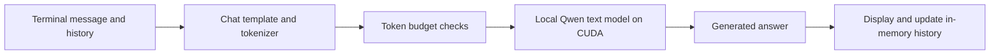

# Qwen with LoRA — Private Local AI Assistant

A local AI assistant built around **Qwen3.5-2B**, with a working offline
terminal chat and a verified GPU training environment. The project is being
developed into a private document assistant that combines retrieval-augmented
generation (RAG) with optional LoRA fine-tuning.

The goal is to answer questions using your own documents while keeping
document processing, inference, and future adapter training on your machine.
The current application runs text inference on an NVIDIA GPU through
PyTorch, Transformers, and Unsloth kernels.

## What the project does

- **Local chat, available now:** run the downloaded Qwen model without a
  hosted inference API. The terminal keeps conversation history in memory
  and supports `/clear` and `/quit`.
- **Document knowledge, planned:** ingest documents, retrieve relevant
  passages from a local vector index, and answer with source references.
  Adding or updating documents will update the knowledge base.
- **LoRA customization, planned:** train small adapters on curated examples
  to customize response style, format, and task behavior. The training tools
  have passed a synthetic adapter test; fine-tuning Qwen itself is pending.

RAG supplies document facts at answer time. LoRA adapts model behavior through
training. They serve different purposes and are intended to work together.

## Current status

| Phase | Scope | Status |
| --- | --- | --- |
| 1 | Python environment, CUDA, GPU forward/backward checks | Verified |
| 2 | Unsloth, PEFT, TRL, quantization kernels, synthetic LoRA update, Jupyter | Verified |
| 3 | Pinned Qwen checkpoint, offline text inference, native convolution acceleration | Verified |
| 4 | Document ingestion, local embeddings, Chroma retrieval, source metadata | Planned |
| 5 | Qwen-specific LoRA training, memory measurements, adapter evaluation | Planned |
| 6 | Web interface for the assistant | Planned |

The current chat uses model knowledge and context you type. Document uploads,
retrieval, citations, and trained Qwen adapters are not connected yet. The
synthetic training check uses a tiny randomly initialized Llama model;
successful inference does not establish that Qwen training fits in VRAM.

## How local chat works



The runtime loads the text component of the pinned Qwen3.5-2B Safetensors
checkpoint in **BF16**, entirely on `cuda:0`, with no CPU or disk offload.
Model loading uses local files and disables remote model code. Optional
Hugging Face telemetry, Unsloth statistics, and Weights & Biases tracking
are disabled by the project's environment settings.

Dependencies and model weights require internet access during initial setup.
Chat and model verification use offline settings afterward. The verification
scripts also check for Python socket/DNS attempts; this is not system-wide
network isolation.

### Measured limits

Results below come from the saved accelerated benchmark on an **RTX 3050
Laptop GPU with 6 GB VRAM**:

| Measurement | Recorded result |
| --- | --- |
| Model | Qwen/Qwen3.5-2B, BF16 text inference |
| Decode throughput | 19.64 tokens/second for the 128-token benchmark |
| Total GPU usage after the 567-token context probe | Approximately 4.62 GiB |
| Conversation smoke checks | 5/5 passed |
| Configured input budget | 768 tokens, including history and chat formatting |
| Maximum generated response | 128 tokens |
| Configured total context cap | 1,024 tokens |

These are individual measurements with short contexts. Performance varies
with hardware and workload, and the smoke checks are not a broad accuracy
evaluation. Long conversations must be cleared or shortened when they exceed
the input budget. Keep the GPU free of other model processes when verifying
or running chat on the tested 6 GB device.

See [model selection and benchmark details](docs/model-selection.md) and the
[accelerated inference report](evaluation/reports/phase3-model-accelerated.json).

## Project structure

```text
backend/
  inference/runtime.py       Local model loading, generation, and token limits
  services/environment.py    Offline defaults, local caches, network-test guard
config/
  model.json                 Model revision, precision, device, token budgets
  model-source.json          Downloaded model file sizes and checkpoint hashes
  requirements-*.txt         Pinned dependencies and tested environment locks
docs/
  setup.md                   Detailed environment setup and verification notes
  model-selection.md         Model/runtime decisions and measured limits
  learning-guide.md          Concepts, process diagrams, and study roadmap
evaluation/
  datasets/                  Conversation smoke-test prompts
  reports/                   Saved GPU, training, and inference results
scripts/
  chat_local.py              Interactive offline terminal chat
  download_model.py          Download and verify the pinned model checkpoint
  verify_*.py                GPU, training-stack, model, and native-kernel checks
  local_env.sh               Project-local cache and privacy settings
  start_notebook.sh          Launch Jupyter on localhost
```

Downloaded weights live in `models/base/Qwen3.5-2B`. The virtual environment,
caches, base models, adapters, document data, vector index, and training
checkpoints are excluded from Git by `.gitignore`.

For a guided explanation of the libraries and the planned RAG/LoRA flows,
read the [learning guide](docs/learning-guide.md).

## Setup and running the project

### 1. Prepare the environment

The verified environment is **Ubuntu 26.04 LTS on WSL2**, **Python 3.12.16**,
and an **NVIDIA RTX 3050 Laptop GPU with 6 GB VRAM**. The runtime requires a
CUDA GPU supporting BF16. Other hardware and operating systems have not been
verified by this project; the pinned native convolution wheel targets Linux
x86-64 and Python 3.12.

Have Git and `uv` available in your Ubuntu shell, and confirm that the GPU is
visible:

```bash
git --version
uv --version
nvidia-smi
```

On WSL2, GPU access comes from the Windows NVIDIA driver. Do not install a
Linux NVIDIA display driver inside WSL. This setup uses prebuilt CUDA wheels
and does not require installing a CUDA toolkit.

### 2. Clone the repository and create the Python environment

Run these commands in Ubuntu, using the Linux filesystem for the checkout:

```bash
git clone https://github.com/imtiyazkumar/qwen-with-lora.git
cd qwen-with-lora

uv --no-config --cache-dir .cache/uv python install 3.12.16
uv --no-config --cache-dir .cache/uv venv --python 3.12.16 .venv
```

If you already have this checkout and its Python 3.12 environment, use them
and continue below. Run all remaining commands from the repository root.

### 3. Install the tested dependencies

The full lock records the tested training and inference stack, including
PyTorch 2.10.0 with CUDA 12.8, Transformers, Unsloth, PEFT, TRL, Jupyter,
and the matching native `causal-conv1d` wheel. Downloads are large; allow
space for the environment, caches, and approximately 4.55 GB of model weights.

```bash
uv --no-config --cache-dir .cache/uv pip install \
  --python .venv/bin/python \
  --default-index https://pypi.org/simple \
  --torch-backend cu128 \
  --only-binary :all: \
  -r config/requirements-training.lock.txt

uv --no-config --cache-dir .cache/uv pip check --python .venv/bin/python

source scripts/local_env.sh
```

The environment script keeps runtime caches inside `.cache/` and defaults
to offline operation. Python commands below use `.venv/bin/python` explicitly,
so activating the virtual environment is optional.

### 4. Verify GPU access

```bash
.venv/bin/python scripts/verify_gpu.py \
  --output evaluation/reports/phase1-gpu.json

.venv/bin/python scripts/verify_causal_conv.py
```

These checks exercise actual GPU operations and the native convolution
extension. Verification commands refresh their saved reports. If an agent
sandbox blocks GPU device access, run them in a normal WSL terminal.

### 5. Download and verify the model

```bash
.venv/bin/python scripts/download_model.py

.venv/bin/python scripts/verify_model.py
```

The downloader explicitly enables online access for this step, fetches the
revision pinned in `config/model.json`, checks downloaded file sizes and
available SHA256 hashes, and records the manifest in `config/model-source.json`.
The model verifier then uses local assets for integrity checks, conversation
smoke tests, and inference benchmarks.

### 6. Start offline terminal chat

```bash
.venv/bin/python scripts/chat_local.py
```

Type a message to chat, `/clear` to reset conversation history, or `/quit`
to exit. Answers are limited to 128 generated tokens. Chat history lasts
only for the running session.

### 7. Optional: use Jupyter and verify the training stack

Register the project kernel after creating or moving the virtual environment:

```bash
source scripts/local_env.sh

.venv/bin/python -m ipykernel install \
  --prefix "$PWD/.venv" \
  --name local-ai \
  --display-name 'Local AI (Python 3.12)'

.venv/bin/python scripts/verify_training.py \
  --output evaluation/reports/phase2-training.json

bash scripts/start_notebook.sh
```

Close terminal chat before running GPU training checks. Open the local URL
printed by Jupyter and select **Local AI (Python 3.12)**. The launcher binds
to `127.0.0.1:8888` with token authentication; stop it with Ctrl+C. Import
Unsloth before Transformers, PEFT, or TRL when writing training notebooks.

See the [detailed setup guide](docs/setup.md) for package versions, what each
verification checks, and environment-specific notes.
