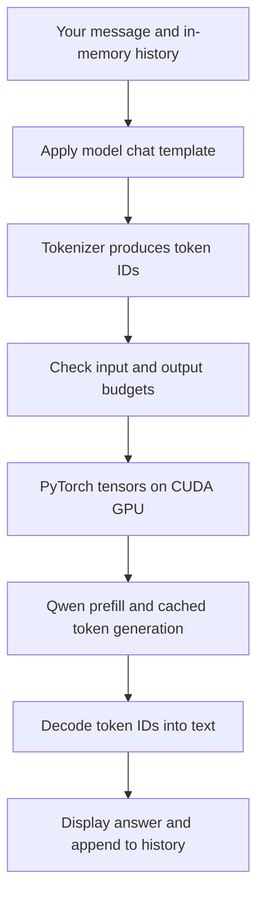
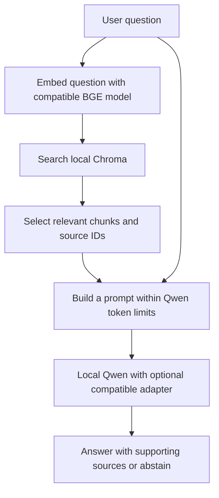
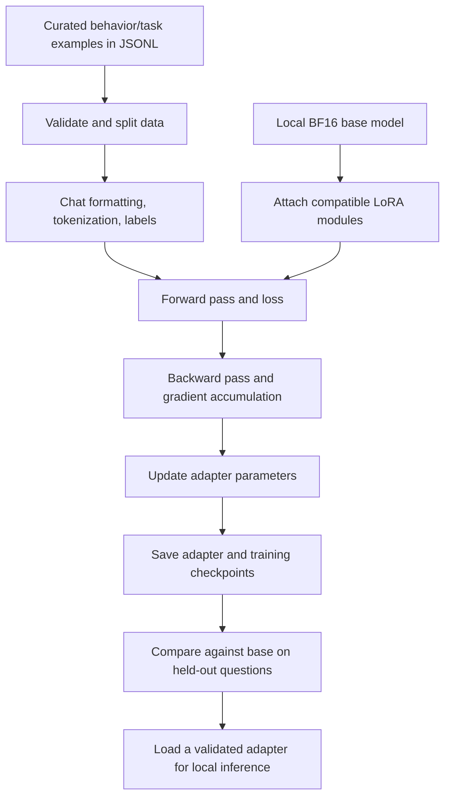

# Learning guide: your private local AI assistant

Use this as a study map and glossary. Learn one group at a time, then follow
the corresponding process flow and inspect the project files listed below.
The learning links are references, not instructions to upgrade installed packages.

## 1. Understand what we are building

The assistant has three separate mechanisms:

| Mechanism | What happens | Example |
| --- | --- | --- |
| Inference | Existing model weights produce an answer from the current input. | Ask Qwen to explain a paragraph. |
| RAG: retrieval-augmented generation | Search your document collection and place useful excerpts into the model's input. | Find the cancellation clause in your uploaded agreement. |
| LoRA fine-tuning | Train a small set of additional parameters to adapt the model. | Teach a preferred response format using curated examples. |

RAG supplies document facts. LoRA is intended here for behavior, style, and
task performance. Fine-tuning can encode facts, but it is not a dependable
replacement for a searchable, updateable document store. Uploading a document
does not automatically train the model.

**Current state:** environment, model inference, and native acceleration are
tested. Document retrieval is planned for Phase 4. Actual Qwen fine-tuning is
planned for Phase 5; the completed training test used a tiny random model.
The professional web interface is planned for Phase 6.

## 2. Python and development environment

| Term | Meaning and connection to this project |
| --- | --- |
| Python | The programming language used for the assistant. Learn variables, lists, dictionaries, functions, classes, imports, exceptions, and file handling first. |
| Interpreter | The program executing Python code. Our interpreter is `.venv/bin/python`, using Python 3.12. |
| Script | A Python file run as a program, such as `scripts/chat_local.py`. |
| Module / package | Reusable Python code imported by another file. A package groups related modules. |
| Library / framework | Reusable software providing functions or larger building blocks. PyTorch supplies numerical computation and training tools. |
| Dependency | A package another package needs. The complete installed environment contains many indirect dependencies. |
| Virtual environment / venv | An isolated project Python environment. Our `.venv` keeps its packages separate from system Python. It does not isolate files, networking, or the GPU. |
| pip | A Python package installer. |
| uv | The package/environment tool used here to resolve and install packages quickly. |
| Wheel / `.whl` | An installable Python package archive. Native wheels must match relevant Python, platform, and binary compatibility requirements. |
| Native extension | Compiled C/C++/CUDA code imported by Python. `causal-conv1d` contains such an extension. |
| Build / compilation | Converting source code into executable code. A matching prebuilt wheel can avoid a local extension build. |
| Version pin | A fixed package version, such as `torch==2.10.0+cu128`. |
| Requirements / lock file | Direct requirements describe chosen packages; our full version lock records the complete tested package set. |
| Configuration | Adjustable settings stored separately from code, such as `config/model.json`. |
| Environment variable | A process setting such as `HF_HUB_OFFLINE=1`. It can control library behavior. |
| JSON | A structured data format used for configurations and reports. |
| JSONL | One JSON object per line. Common for training examples because records can be processed individually. |
| YAML | Another human-readable configuration format, often used for training settings. |
| Git / revision | Git tracks source history; a revision identifies a particular version. Our model download also pins an upstream revision. |
| SHA256 / checksum | A digest used to detect file changes or corruption. Matching it verifies the bytes against the recorded digest; it does not prove model quality. |

Study reference: [Python tutorial](https://docs.python.org/3.12/tutorial/).

## 3. Hardware, Windows, WSL, and CUDA

| Term | Meaning and connection |
| --- | --- |
| CPU | General-purpose processor. It runs application logic, parsing, and many other tasks. |
| GPU | Processor designed for highly parallel numerical operations. Your NVIDIA RTX 3050 runs the language model. |
| RAM | System working memory. Your laptop has 16 GB installed. WSL has its own visible memory limit. |
| VRAM | Dedicated GPU working memory. Your 6 GB limit constrains model weights and intermediate computation. |
| SSD / storage | Persistent space for weights, documents, indexes, and checkpoints. Disk capacity is different from working memory. |
| Swap | Disk-backed memory used under system-memory pressure. It is much slower than RAM and does not turn into dedicated VRAM. |
| WSL2 | Windows Subsystem for Linux 2: runs a Linux environment using a lightweight virtual machine. |
| Ubuntu | The Linux distribution running inside WSL2. We retained Ubuntu 26.04. |
| Linux kernel | The operating system core. This meaning of “kernel” differs from GPU and Jupyter kernels. |
| NVIDIA driver | Provides operating-system access to the GPU. WSL uses GPU support from the Windows driver. |
| CUDA | NVIDIA's platform for GPU computation. PyTorch uses CUDA libraries to execute work on your NVIDIA GPU. |
| CUDA runtime | Libraries used when CUDA applications execute. Our PyTorch build uses CUDA 12.8. |
| CUDA Toolkit / nvcc | Development tools, including NVIDIA's CUDA compiler. Not required to run every prebuilt CUDA application; we did not install a toolkit for the convolution fix. |
| cuBLAS / cuDNN | NVIDIA libraries supplying optimized operations such as matrix multiplication and neural-network primitives. |
| `nvidia-smi` | A diagnostic tool for the GPU and driver. Its displayed CUDA version describes driver capability, not the installed PyTorch runtime version. |
| Device / `cuda:0` | Where tensors live. `cuda:0` names the first visible CUDA GPU; `cpu` names system execution. |
| Compute capability | NVIDIA GPU architecture feature level. Your RTX 3050 reports 8.6. |
| GPU kernel | A function executed in parallel on the GPU. Faster kernels can implement the same model operation more efficiently. |
| Triton | A language/compiler system for GPU kernels. Unsloth uses Triton-based operations. |
| JIT compilation | Compilation when code is first used. First-run latency can exceed later runs because kernels need compilation. |
| Ninja | A build execution tool. It is a declared dependency of the installed convolution package. |
| ABI | Application Binary Interface: rules compiled components must agree on. Our wheel selection matched PyTorch's C++ ABI as well as Python and CUDA compatibility. |
| CPU offload | Keeping some model work or weights off the GPU. It changes memory and performance behavior. The verified inference configuration uses no CPU/disk offload. |
| OOM | Out of memory. An inference workload can fit while a training workload still runs out of VRAM. |

There are three CUDA-related versions to distinguish: Windows driver
capability, the runtime used by PyTorch, and a toolkit compiler version if
one is installed. They need compatibility, not identical version labels.
See [NVIDIA's WSL guide](https://docs.nvidia.com/cuda/wsl-user-guide/index.html).

## 4. Machine learning, tensors, and PyTorch

| Term | Meaning |
| --- | --- |
| Machine learning / ML | Learning useful behavior from data by adjusting parameters. |
| Neural network | A composition of numerical operations with trainable parameters. |
| Deep learning | Machine learning using neural networks with many layers. |
| Scalar / vector / matrix | One number / an ordered collection of numbers / a two-dimensional arrangement of numbers. |
| Tensor | A multidimensional numerical array. Model weights, token IDs, and activations are represented as tensors. |
| Shape | Tensor dimensions, such as `[batch, sequence, hidden_size]`. |
| Matrix multiplication | A core operation combining arrays of numbers, written as `@` in PyTorch. |
| Parameter / weight | A numerical value learned during training. “Weights” often refers collectively to stored model parameters. |
| Architecture | How layers and operations are connected. Architecture and learned weights are separate things. |
| Forward pass | Computing outputs from inputs with the current parameters. |
| Activation / intermediate state | Values computed inside the model. They also consume memory. |
| Loss | A numerical training objective measuring prediction error. Lower training loss alone does not establish better real-world answers. |
| Gradient | How a small parameter change would change the loss. |
| Autograd | Automatic differentiation: PyTorch tracks operations needed to compute gradients. |
| Backpropagation / backward pass | Computing gradients through the network from the loss. |
| Optimizer | Updates trainable parameters using gradients; AdamW is one example. |
| Learning rate | Controls the scale of optimizer updates. |
| `requires_grad` | Marks tensors whose gradients should be tracked. |
| `torch.no_grad()` / `torch.inference_mode()` | Contexts that disable gradient recording for inference; inference mode has additional restrictions and optimizations. |

**PyTorch versus `torch`:** PyTorch is the framework's name. `torch` is its
main Python import/package name. They refer to the same core software here:

```python
import torch
```

The model is Qwen. Transformers supplies its Python implementation and loading
tools. PyTorch carries out tensor operations. CUDA executes GPU operations.
Unsloth adds model/training optimizations and local optimized kernels.

### A small training example

This CPU example is independent of Qwen and does not alter its weights:

```python
import torch

x = torch.tensor([2.0], requires_grad=True)
loss = (x - 5).pow(2).mean()
loss.backward()

print(loss.item())   # 9.0
print(x.grad.item()) # -6.0

with torch.no_grad():
    x -= 0.1 * x.grad

print(x.item())      # approximately 2.6: one update moved x closer to 5
```

Here, the target is 5, the current value is 2, and the learning rate is 0.1.
The same forward → loss → gradient → update pattern scales to neural networks.
Study reference: [PyTorch basics](https://docs.pytorch.org/tutorials/beginner/basics/intro.html).

## 5. Language models and generation

| Term | Meaning and connection |
| --- | --- |
| NLP | Natural language processing: computational work involving human language. |
| LLM | Large language model: a language-processing neural model with many learned parameters. |
| Open-weight model | Model weights are available under a license. This does not automatically mean all training data/code is available or all uses are unrestricted. |
| Pretraining | Initial large-scale model training. We are not pretraining Qwen. |
| Instruction tuning | Training a model to follow instructions and respond to conversations. |
| Base versus instruction model | A raw pretrained model and a model adapted for instructions differ. Our directory `models/base` means the original checkpoint before our adapters; it does not mean Qwen is an untuned raw pretraining model. |
| Qwen3.5-2B | Our selected model family/size. Its loaded text component contains about 1.88 billion parameters. |
| Multimodal / VLM | A model supporting more than text, such as vision-language input. The published checkpoint contains vision components; our current runtime loads text components only. |
| Transformer | An architecture family using attention and other layers. Qwen3.5 combines full attention with Gated Delta layers rather than using full attention in every layer. |
| Attention | A mechanism that weights information from other token positions when computing a representation. |
| Q, K, V | Query, key, and value representations used by attention. These are internal numerical representations. |
| SDPA | Scaled dot-product attention, an attention operation exposed by PyTorch. It is not itself an entire model. |
| Gated Delta Network / GDN | Qwen3.5's state-based linear-attention component. Learn this after ordinary attention. |
| Token | A unit handled by the model: often part of a word, punctuation, whitespace, or a control symbol. A token is not always a whole word. |
| Tokenizer | Converts text to token IDs and decodes generated IDs back to text. |
| Vocabulary | Token IDs and their associated token representations. |
| Token embedding | An internal learned numerical representation of a token. This differs from the document embeddings used for retrieval. |
| Prompt | The complete input supplied to the model for a response. |
| System / user / assistant messages | Roles used to structure conversations and instructions. |
| Chat template | Converts role-tagged messages into the exact token/control-symbol structure expected by the model. |
| Context window | The maximum sequence the model can work with for a request, constrained by architecture, runtime, and memory. |
| Input budget | How many tokens we allow for instructions, history, question, and document context. |
| Output limit / `max_new_tokens` | The maximum number of new tokens generated for a response. |
| Truncation | Cutting content to a limit. Our chat rejects oversized input and marks responses that reach the output cap. |
| Autoregressive generation | Producing successive tokens conditioned on previous tokens. |
| Logits / softmax | Numerical token scores / conversion of scores into a probability distribution. |
| Greedy decoding | Select the highest-scoring next token. Our current benchmark uses this approach. |
| Temperature | Adjusts the sharpness of the distribution when sampling. Low temperature does not guarantee truth. |
| Top-k / top-p | Restrict sampling to a fixed number of candidates / a set covering a chosen cumulative probability. |
| Prefill | Processing the input prompt before generating the response. |
| Decode | Generating subsequent output tokens. |
| KV cache | Stored attention keys/values reused during generation. Qwen's linear-attention layers also maintain recurrent states. |
| TTFT | Time to first token. It measures responsiveness before the rest of an answer appears. |
| Tokens/second | Generation throughput. Specify whether prompt processing is included when comparing reports. |

Our application currently allows **768 input tokens**, **128 new tokens**,
and a **1,024-token total cap**. Instructions and history consume input tokens
too. A model's advertised maximum context does not mean your laptop can use
that maximum. Our larger tested prompt had 567 tokens.

Study reference: [Hugging Face LLM course](https://huggingface.co/learn/llm-course/chapter1/1).

## 6. Precision, quantization, and GPU memory

| Term | Meaning |
| --- | --- |
| dtype | Numerical data type used to store values, such as FP32 or BF16. |
| FP32 | A 32-bit floating-point representation: 4 bytes per value. |
| FP16 | A 16-bit floating-point representation: 2 bytes per value, with a different precision/range tradeoff from BF16. |
| BF16 | Bfloat16: 2 bytes per value with FP32-like exponent range and less precision. This is our model's current weight dtype. |
| Mixed precision | Using different numerical representations for different parts of computation. Not every tensor must share the weight dtype. |
| Quantization | Representing values with fewer bits or a constrained set of levels to reduce storage/computation costs. It can change numerical behavior. |
| 4-bit / NF4 | Low-bit representations; NF4 is one used by bitsandbytes. Four-bit weight storage does not mean every computation or state uses four bits. |
| Dequantization | Converting quantized values to a representation used for computation. |
| Allocated versus reserved memory | PyTorch tensors consume allocated memory; its allocator may reserve additional space for reuse. |
| Total GPU memory usage | Also includes contexts, libraries, other applications, and allocations beyond the reported tensor counter. |
| GB versus GiB | Decimal versus binary units: 1 GB = 1,000,000,000 bytes; 1 GiB = 1,073,741,824 bytes. |

Approximate weight storage:

```text
parameter count × bytes per parameter
1.88 billion × 2 bytes ≈ 3.76 GB ≈ 3.50 GiB
```

That calculation excludes activations, caches, library workspaces, allocator
overhead, and the CUDA context. Training adds gradients and optimizer state
for trainable parameters, plus the state needed for backward computation.
This explains why “weights fit” and “training fits” are different tests.

## 7. RAG and document knowledge — Phase 4

| Term | Meaning and planned use |
| --- | --- |
| Knowledge base | The document collection and searchable data derived from it. |
| Ingestion | Bringing files into the knowledge system and processing them. |
| Parser / extraction | Reading useful text and structure from PDF, DOCX, TXT, or Markdown. |
| PyMuPDF / python-docx | Planned Python libraries for extracting PDF and Word content. |
| OCR | Optical character recognition: converting text in images/scans into machine-readable text. Scanned PDFs may require this additional step. |
| Chunk | A manageable document excerpt used for retrieval. |
| Chunk overlap | Shared text between neighboring chunks to preserve context at boundaries. |
| Metadata | Supporting information: document ID, filename, page, heading, chunk ID, and version. |
| Document ID / chunk ID | Stable identifiers used to track sources and manage updates/deletions. |
| Content hash / deduplication | Detecting identical content so unchanged or duplicate files are not repeatedly indexed. |
| Embedding | A numerical representation used to compare text meaning. It is not a human-readable summary. |
| Embedding model | A model that produces retrieval vectors. This is separate from the generative Qwen model. |
| BGE-small-en-v1.5 | Planned English embedding model from BAAI. Its vectors have 384 dimensions. |
| Vector dimension | The number of coordinates in an embedding. It is not the number of documents or words. |
| Embedding space | The representation system produced by a particular embedding model. Questions and documents must use compatible representations. |
| Vector database / ChromaDB | Planned local storage for vectors, document chunks, and metadata, with similarity-search functionality. |
| Collection / index | A logical group of searchable records / supporting search data structures. |
| Semantic search | Retrieval using representations of meaning, allowing relevant matches without exact wording. |
| Cosine similarity | A common way to compare vector directions. Search scores depend on the configured metric and are not probabilities that an answer is correct. |
| ANN | Approximate nearest-neighbor search: trading exact exhaustive comparison for efficient retrieval. |
| Top-k retrieval | Return a chosen number of search results. This use of top-k is different from top-k token sampling. |
| Metadata filter | Limit search by document, type, or other stored attributes. |
| Reranking | An optional second stage that orders candidate excerpts using a stronger relevance model. |
| Hybrid search / BM25 | Optional combinations of semantic and keyword-based retrieval. Useful to learn after basic semantic search. |
| Grounding | Building an answer around supplied evidence. Retrieval helps, but does not guarantee correctness. |
| Citation / source attribution | Connecting answer claims to the actual document/page/excerpt supporting them. An existing citation can still be irrelevant or incorrect. |
| Abstention | Saying the information is unavailable rather than guessing. |
| Upsert / reindexing | Add or update indexed records / rebuild derived search data. Changing the embedding model normally requires re-embedding the collection. |
| Prompt injection | Instructions inside untrusted content that try to redirect the assistant. Retrieved documents must be treated as evidence, not authority to change application instructions. |

Ingestion usually happens when documents change. Retrieval happens when you
ask a question. Adding documents does not require retraining Qwen. A large
collection can live on disk while only a few excerpts enter each prompt.
The exact chunk counts must respect both the embedding model's input limits
and Qwen's separate token budget; their tokenizers can count differently.

References: [BGE model card](https://huggingface.co/BAAI/bge-small-en-v1.5),
[Chroma introduction](https://docs.trychroma.com/docs/overview/introduction).

## 8. Fine-tuning and LoRA — Phase 5

| Term | Meaning and planned use |
| --- | --- |
| Fine-tuning | Further training an existing pretrained model on chosen examples. |
| SFT | Supervised fine-tuning using examples of desired outputs or conversations. |
| Dataset | A collection of training or evaluation examples. |
| Train / validation / test splits | Examples for learning / development decisions / final evaluation. Keep evaluation data separate from training. |
| Data leakage | Evaluation information unintentionally influences training or model-selection decisions, making results misleading. |
| Overfitting / generalization | Learning training examples too specifically / working well on new examples. |
| PEFT | Parameter-efficient fine-tuning: train a subset or small additions instead of every model parameter. Also the name of Hugging Face's implementation library. |
| LoRA | Low-Rank Adaptation: train smaller update matrices while freezing original weights. |
| Adapter | Saved additional parameters and configuration used with the compatible base model. It usually does not contain the complete model. |
| Rank / `r` | Size of the low-rank update representation. Larger ranks add trainable capacity and memory requirements. |
| Alpha | A LoRA update scaling parameter. It is different from the optimizer's learning rate. |
| Target modules | Layers where adapters are attached. Architecture-specific names matter. |
| Frozen parameters | Weights excluded from optimizer updates. They can still participate in computations needed for adapter gradients. |
| QLoRA | LoRA training using a quantized base model, with higher-precision computation where needed. It is not automatically appropriate for every architecture. |
| Batch size | Examples processed together in one batch; sequence lengths affect their memory use. |
| Microbatch | A small batch used before accumulating gradients across multiple passes. |
| Gradient accumulation | Combine gradients from multiple microbatches before an optimizer update. |
| Optimizer step | One parameter update after the required gradients have accumulated. |
| Epoch | A pass through the training dataset. |
| Sequence length | Token length allowed for a training example or packed sequence. |
| Padding / attention mask | Filling shorter sequences to a common length / identifying which positions should participate. |
| Labels / loss mask | Target tokens and the positions contributing to training loss. Instruction-tuning may train primarily on assistant responses. |
| Learning-rate schedule / warmup | How the learning rate changes over training / gradually increasing it at the start. |
| Gradient checkpointing | Recompute selected forward operations during backward to save activation memory, trading extra work for reduced memory. |
| Training checkpoint | Saved model/adapter and possibly optimizer, scheduler, and progress state. This is different from gradient checkpointing. |
| Resume | Continue interrupted training from a suitable saved checkpoint. An adapter alone is not necessarily enough to reproduce the optimizer state. |
| Adapter loading / unloading | Activate or remove adapter effects without replacing the original model checkpoint. |
| Merge / export | Combine adapter updates into compatible base weights / convert the result for a target runtime. Quantized formats and architectures need explicit compatibility checks. |

For ordinary LoRA, a useful mathematical view is:

```text
effective weight = original weight + (alpha / rank) × B × A
```

`A` and `B` are the small trainable matrices. For a 2,048 × 2,048 matrix,
the original matrix contains 4,194,304 values. Rank-8 LoRA adds
`8 × 2048 + 2048 × 8 = 32,768` values for that matrix, about 0.78% as many.
This example describes one matrix, not the entire model's training memory.
See the [PEFT LoRA conceptual guide](https://huggingface.co/docs/peft/main/en/conceptual_guides/lora).

Our intended starting settings are rank 8, alpha 16, batch 1, sequence length
512, accumulation 8, gradient checkpointing, and one epoch. On one GPU,
batch 1 × accumulation 8 corresponds approximately to eight examples per
optimizer update, without keeping eight microbatches' activations at once.
Token counts and loss normalization also matter.

We plan **BF16 LoRA for Qwen3.5**, following the
[model-specific Unsloth guidance](https://unsloth.ai/docs/models/qwen3.5/fine-tune).
bitsandbytes/NF4 operations passed tests, but that does not establish that
4-bit training is the right choice for this architecture. Actual Qwen training
fit remains unmeasured.

## 9. What each installed tool does

| Name | Role |
| --- | --- |
| PyTorch / `torch` | Tensors, numerical execution, automatic gradients, and optimization primitives. |
| NumPy | General numerical arrays and CPU-side data operations. |
| Transformers | Model definitions, tokenizer integration, checkpoint loading, and generation interfaces. |
| Hugging Face Hub | Hosts downloadable model assets; downloading weights is separate from sending prompts to hosted inference. Our inference uses local files. |
| Unsloth | Model/training optimizations, patches, and optimized kernels. |
| Unsloth Zoo | Supporting utilities and bundled implementation components used by Unsloth. |
| PEFT library | Creates and manages parameter-efficient adapters such as LoRA. |
| TRL | Training utilities including the SFT trainer used in our synthetic test. |
| Accelerate | Helps manage devices and training execution, including mixed precision. |
| Datasets | Loads, represents, and processes datasets. |
| bitsandbytes | Quantized operations and related memory-saving tools. Installed does not mean our current model weights use 4-bit storage. |
| TorchAO | PyTorch-oriented quantization tools; pinned to a compatible version. |
| xformers | Optimized neural-network operations. Its attention kernel passed a separate test; this does not mean every model attention call uses xformers. |
| SDPA | The attention interface configured in our model runtime. |
| FLA | Flash Linear Attention implementations; Unsloth supplies bundled Gated Delta kernels. This differs from full-attention FlashAttention. |
| `causal-conv1d` | Native CUDA causal-convolution operations used by Qwen's Gated Delta path. |
| Triton | Builds/runs specialized GPU kernels used by optimized implementations. |
| TorchVision / Pillow | Vision and image utilities available because the broader model stack can support multimodal workflows. |
| Jupyter Notebook | Browser interface for interactive code, text, and results. |
| IPython / ipykernel | Interactive Python execution tools and the Python process serving a Jupyter notebook. |

**Jupyter kernel** means an execution process. **GPU kernel** means a GPU
function. **Linux kernel** means the operating-system core. Context matters.

## 10. Application, file formats, privacy, and testing

| Term | Meaning and project connection |
| --- | --- |
| Frontend / UI | What you interact with: chat, uploads, source links, and settings. The professional web UI is still planned. |
| Backend | Code coordinating inference, document processing, storage, and requests. |
| API / endpoint | A programmatic interface / a particular address for an operation. An API can run locally; it is not inherently a cloud service. |
| HTTP / JSON request | A common web communication protocol / structured request data used by web applications. |
| Runtime | Software executing model inference. Our tested runtime uses Transformers and local optimized kernels. |
| llama.cpp | Alternative native inference software, often used with GGUF. Evaluated upstream support, not installed/tested here. |
| Ollama / LM Studio | Alternative local model-serving/desktop tools. They are not required for the current Python runtime. |
| AnythingLLM | A candidate ready-made document/chat application to evaluate for the future UI. Not installed in this project. |
| Safetensors | Format used for our stored model tensors. Loading model tensors is separate from executing arbitrary remote model code. |
| GGUF | An alternative model format used by runtimes such as llama.cpp. A compatible export is a separate step. |
| localhost / `127.0.0.1` | Loopback address used by local services. Our Jupyter launcher binds here. |
| Port | Identifies a service on a machine; Jupyter's configured port is 8888. |
| Authentication token | A credential used to access a service. Jupyter's login token is unrelated to LLM text tokens. |
| Cache | Reusable local assets or computation results. It is different from the document index and from chat history. |
| Offline mode | Configuration to use downloaded assets without fetching missing ones. It is distinct from physically disconnecting networking. |
| Telemetry | Optional reporting of usage/environment information. Relevant optional telemetry is disabled in our launch settings. |
| Reproducibility | Recording code, assets, versions, configurations, data, and evaluation conditions so a result can be investigated or repeated. |
| Smoke test | A small check that essential behavior works. Five successful questions do not establish broad answer accuracy. |
| Baseline / regression | A reference result before a change / behavior that worsens after a change. |
| Benchmark | A defined workload with measurements. Our latest longer-response run measured 19.64 decode tokens/second; individual runs vary. |
| Retrieval recall@k | Fraction of relevant items found among the top-k retrieved results, for a defined evaluation set. |
| Answer correctness / groundedness | Whether an answer is right / whether its claims are supported by supplied evidence. They are related but different. |
| Hallucination | A generated claim unsupported by reality or the available evidence. Fluent text can still be wrong. |
| Citation validity | Whether cited material exists and supports the associated claim. |
| Determinism / random seed | Controlling randomness to improve repeatability. A seed does not guarantee bit-identical results across every hardware/kernel/version combination. |

Private documents, embeddings, conversations, and adapters can all contain
sensitive information. An embedding or adapter should not be assumed anonymous.
Our current offline tests use local assets, offline flags, and Python network
blocking; they do not claim whole-system firewall isolation.

## 11. Process flow A: what happens when you chat today



Transformers coordinates the model and generation. PyTorch executes tensor
operations. CUDA libraries and native/Triton kernels execute GPU computation.
Generation does not update model weights. Today's chat history lives in the
running process; `/clear` removes that conversational context.

## 12. Process flow B: document ingestion and RAG

These are planned flows, not features already connected to the chat.




For example, a document chunk says “Cancellation requires 14 days' notice.”
The question “How early must I cancel?” can retrieve it through semantic
similarity. The answer should cite that chunk's actual document/page.
If no document supports the answer, the assistant should make that clear.

## 13. Process flow C: LoRA training



The document index is not an input to the optimizer unless we deliberately
construct a training dataset from some content. That is not our default plan.
Normal document additions and removals should update the knowledge base.

## 14. Study order and practical checkpoints

| Order | Study | You are ready to continue when you can… |
| --- | --- | --- |
| 1 | Python basics, terminal, modules, venv, pip/uv, JSON | Explain which Python runs a script and where its packages are installed. |
| 2 | Scalars, vectors, matrices, tensors, shapes, dtype | Read a tensor shape and estimate its storage. |
| 3 | PyTorch, forward pass, loss, autograd, optimizer | Explain the small `x → loss → gradient → update` example above. |
| 4 | CPU/GPU, RAM/VRAM, WSL2, driver/runtime/toolkit | Explain why a model can fit on disk yet fail on the GPU. |
| 5 | Tokenizer, chat template, attention, prefill/decode, context | Trace a typed question into token IDs and back into generated text. |
| 6 | Embeddings, chunking, semantic search, vector DB, citations | Explain how new documents become searchable without changing Qwen weights. |
| 7 | SFT, datasets/splits, LoRA, rank/alpha, accumulation | Explain which weights change and how an adapter is evaluated. |
| 8 | Backend/API/UI, privacy, offline tests, benchmarks | Explain where each kind of data goes and how you would verify correctness. |
| Later | GDN internals, custom CUDA/Triton, advanced quantization, reranking | Read performance implementations after understanding the functional pipeline. |

You do not need to write CUDA kernels or train an LLM from scratch to build
and operate this assistant. Start with the first five groups, then RAG before
model-specific fine-tuning. The links above are conceptual learning resources;
examples on their latest pages may use package versions different from ours.

## 15. Read your project in this order

| File | Concepts to recognize |
| --- | --- |
| `config/model.json` | Model identity, precision, device, attention, and token budgets. |
| `scripts/chat_local.py` | User input, history, role messages, generation, `/clear`. |
| `backend/inference/runtime.py` | Local loading, tokenizer, chat template, GPU tensors, generation, memory/timing. |
| `backend/services/environment.py` | Offline configuration, cache locations, network-test guard. |
| `scripts/verify_gpu.py` | Forward/backward passes and CUDA verification. |
| `scripts/verify_training.py` | Synthetic SFT, LoRA, frozen parameters, adapter saving/loading. |
| `scripts/verify_causal_conv.py` | Native operations, reference comparisons, gradients, state updates. |
| `evaluation/datasets/model-smoke.json` | Evaluation prompts and basic expected-answer checks. |
| `evaluation/reports/phase3-acceleration-comparison.json` | Baseline versus measured change, latency, throughput, and memory. |
| `config/requirements-training.lock.txt` | Dependencies and reproducible package versions. |

Read [setup.md](setup.md) for commands and
[model-selection.md](model-selection.md) for the model/runtime decisions.
